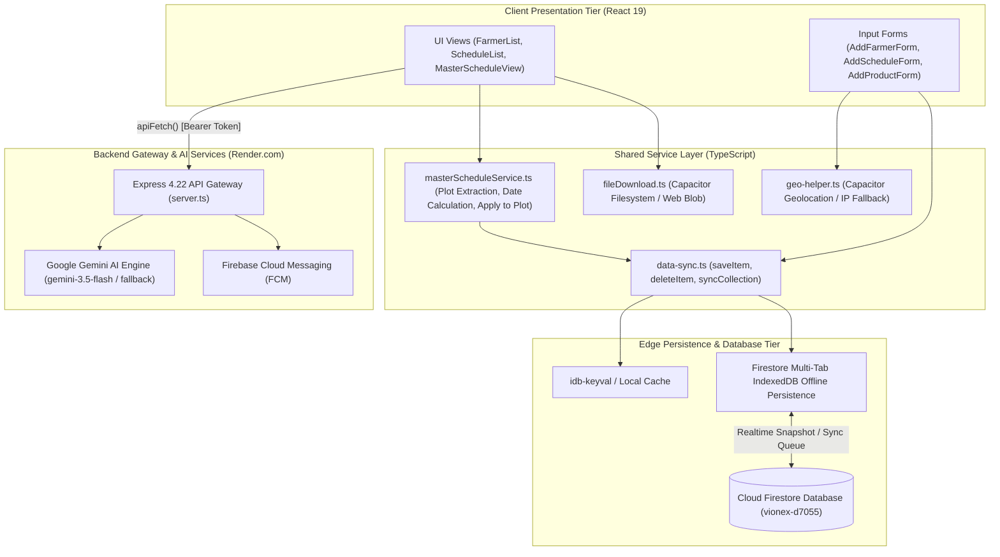

# VIONEX Platform — Comprehensive Technical Project Analysis

**Document Status:** Complete Internal Analysis  
**Repository Working Directory:** `d:\VIONEX\vionex`  
**Generated Date:** October 2026  
**Inspection Type:** Non-destructive, read-only deep static code analysis  

---

## 1. Project Identity

| Attribute | Repository Value | Verification Source |
|---|---|---|
| **Project / Product Name** | VIONEX (Vionex - Smart Farming) | `capacitor.config.ts` (line 5), `index.html` (line 13), `src/lib/config.ts` (line 27) |
| **Package ID / Android Application ID** | `com.vionex.smartfarming` | `capacitor.config.ts` (line 4), `android/app/build.gradle` (lines 13, 16) |
| **Current Web & Core Package Version** | `1.2.4` | `package.json` (line 4), `vite.config.ts` (line 32) |
| **Current Android Version** | `versionCode 5`, `versionName "1.2.4"` | `android/app/build.gradle` (lines 19, 20) |
| **Firebase Project Identifier** | `vionex-d7055` | `server.ts` (line 55), `src/lib/firebase.ts` (line 7), `firebase-applet-config.json` |
| **Live Web Hosting URL** | `https://vionex-4woy.onrender.com` | `src/lib/config.ts` (line 12), `server.ts` (lines 814–837) |

### 1.1 Purpose
VIONEX is an enterprise-grade Smart Agriculture and Crop Care Management platform engineered to operate reliably in low-bandwidth rural environments. It provides agri-input dealers, agricultural consultants, and smallholder farmers with a cross-platform system for crop diagnosis, spray protocol generation, agrochemical inventory discovery, and field records management.

### 1.2 Target Users
1. **Agri-Input Dealers (Primary Users):** Rural retail dealers who stock agrochemicals and act as grassroots consultants for farming communities. They use VIONEX to manage customer farmer profiles, generate custom plot spray schedules, track product inventory, and maintain sales auditability (`src/components/DealersView.tsx`, `src/types.ts` lines 196–222).
2. **Agricultural Consultants & Field Agronomists:** Independent crop specialists who create master spray templates, register farmers in their working territory, and monitor field plots (`src/components/ConsultantsView.tsx`, `src/types.ts` lines 298–311).
3. **Corporate & System Administrators:** System supervisors managing staff role delegations, approving new product entries, reviewing activity logs, and managing platform security (`src/components/AdminView.tsx`, `src/types.ts` lines 145–153).
4. **Smallholder Farmers:** End-user growers who log in via mobile number to view personalized day-wise spray calendars, record treatment completion ("Mark Done"), and receive local weather alerts (`src/components/LoginScreen.tsx` lines 105–119, `src/components/ScheduleList.tsx` line 73).

### 1.3 Problem Solved
Smallholder farmers in regions such as Maharashtra (e.g., Sangli, Satara, Solapur, Yavatmal, Nashik) suffer significant seasonal yield loss (20% to 40%) due to uncalibrated chemical dosages, pesticide resistance, and delayed treatment of fungal and insect infestations (e.g., downy mildew in grapes, pink bollworm in cotton, fall armyworm in maize). Historically, dealers and farmers relied on handwritten notebooks or unindexed WhatsApp chats. 

Furthermore, rural connectivity is unstable, with frequent drops to 2G or complete signal loss. Standard web applications lock up, time out, or corrupt data when networks drop. VIONEX solves this by implementing an offline-first dual-tier storage engine (IndexedDB + Cloud Firestore Local Persistence), confirmed-write database transactions, standardized master schedule decoupling, and localized administrative revenue village mapping.

---

## 2. Technology Stack & Exact Versions

All versions cited below are drawn directly from `package.json`, `android/build.gradle`, and `android/variables.gradle`:

### 2.1 Frontend Core & Build Tooling
- **React:** `^19.0.1` (`package.json`, line 48)
- **React DOM:** `^19.0.1` (`package.json`, line 49)
- **TypeScript:** `~5.8.2` (`package.json`, line 68)
- **Vite:** `^6.2.3` (`package.json`, lines 52, 69)
- **@vitejs/plugin-react:** `^5.0.4` (`package.json`, line 28)
- **Tailwind CSS:** `^4.1.14` (`package.json`, line 66)
- **@tailwindcss/vite:** `^4.1.14` (`package.json`, line 27)
- **Autoprefixer:** `^10.4.21` (`package.json`, line 62)
- **esbuild:** `^0.25.0` (`package.json`, line 63)
- **tsx:** `^4.21.0` (`package.json`, line 67)

### 2.2 Backend & Microservices Runtime (`server.ts`)
- **Node.js Type Definitions:** `@types/node` `^22.14.0` (`package.json`, line 61)
- **Express:** `^4.22.2` (`package.json`, line 32)
- **Express Rate Limit:** `^8.6.1` (`package.json`, line 33)
- **Helmet:** `^8.3.0` (`package.json`, line 36)
- **CORS:** `^2.8.6` (`package.json`, line 29)
- **HPP (HTTP Parameter Pollution Protection):** `^0.2.3` (`package.json`, line 37)
- **Multer:** `^2.2.0` (`package.json`, line 47)
- **Dotenv:** `^17.2.3` (`package.json`, line 31)

### 2.3 Cloud Persistence & Authentication
- **Firebase Client SDK:** `^12.14.0` (`package.json`, line 34; `src/lib/firebase.ts`, lines 1–4)
  - Cloud Firestore (Multi-Tab IndexedDB persistence enabled)
  - Firebase Authentication (Anonymous Auth, Email/Password, Isolated secondary apps)
  - Firebase Cloud Messaging (`getMessaging`)
- **Firebase Admin SDK:** `^14.0.0` (`package.json`, line 35; `server.ts`, lines 13–16)
  - Token verification middleware (`requireAuth`, `requireAdmin`)
  - Cloud Messaging backend dispatch (`/api/send-notification`)
- **Client Key-Value Storage:** `idb-keyval` `^6.3.0` (`package.json`, line 41; `src/hooks/useMasterLocations.ts`, line 7)

### 2.4 Multimodal Artificial Intelligence
- **Google GenAI SDK:** `@google/genai` `^2.4.0` (`package.json`, line 26; `server.ts`, line 11)
- **Referenced Gemini Models in `server.ts`:**
  - `gemini-1.5-flash` (`server.ts`, lines 202, 389)
  - `gemini-3.5-flash` (`server.ts`, lines 432, 471, 625, 682, 754)
  - `gemini-flash-latest` (`server.ts`, line 210)
  - `gemini-3.1-flash-lite` (`server.ts`, lines 209, 210)

### 2.5 Capacitor Android Mobile Runtime
- **@capacitor/core:** `^8.4.2` (`package.json`, line 19)
- **@capacitor/android:** `^8.4.2` (`package.json`, line 16)
- **@capacitor/cli:** `^8.4.2` (`package.json`, line 56)
- **@capacitor/app:** `^8.1.1` (`package.json`, line 17)
- **@capacitor/camera:** `^8.2.1` (`package.json`, line 18)
- **@capacitor/filesystem:** `^8.1.2` (`package.json`, line 20)
- **@capacitor/geolocation:** `^8.2.0` (`package.json`, line 21)
- **@capacitor/network:** `^8.0.1` (`package.json`, line 22)
- **@capacitor/push-notifications:** `^8.1.2` (`package.json`, line 23)
- **@capacitor/share:** `^8.0.3` (`package.json`, line 24)
- **@capacitor/toast:** `^8.0.1` (`package.json`, line 25)

### 2.6 Native Android Toolchain Configuration
- **Android Gradle Plugin:** `8.13.0` (`android/build.gradle`, line 10)
- **Google Services Plugin:** `4.4.4` (`android/build.gradle`, line 11)
- **Compile SDK:** `36` (`android/variables.gradle`, line 3)
- **Target SDK:** `36` (`android/variables.gradle`, line 4)
- **Min SDK:** `24` (Android 7.0 Nougat) (`android/variables.gradle`, line 2)
- **AndroidX AppCompat:** `1.7.1` (`android/variables.gradle`, line 6)
- **AndroidX CoordinatorLayout:** `1.3.0` (`android/variables.gradle`, line 7)
- **Core SplashScreen:** `1.2.0` (`android/variables.gradle`, line 10)
- **Cordova Android Version:** `14.0.1` (`android/variables.gradle`, line 15)

### 2.7 Utilities, Export & Document Generation
- **Lucide React (Icons):** `^0.546.0` (`package.json`, line 45)
- **Motion (Framer Motion replacement):** `^12.23.24` (`package.json`, line 46)
- **Date-fns:** `^4.4.0` (`package.json`, line 30)
- **React-Markdown:** `^10.1.0` (`package.json`, line 50)
- **jsPDF:** `^4.2.1` (`package.json`, line 43)
- **jsPDF-AutoTable:** `^5.0.8` (`package.json`, line 44)
- **html2canvas:** `^1.4.1` (`package.json`, line 39)
- **html-to-image:** `^1.11.13` (`package.json`, line 38)
- **html2pdf.js:** `^0.14.0` (`package.json`, line 40)
- **XLSX (SheetJS):** `^0.18.5` (`package.json`, line 53)
- **Geographic Datasets:** `india-pincode-finder` `^4.0.1` (`package.json`, line 42), `rwanda-geo` `^1.4.6` (`package.json`, line 51)
- **PWA Service Worker:** `vite-plugin-pwa` `^1.3.0` (`package.json`, line 70), custom service worker `public/sw.js` (Cache identifier: `vionex-v13`)

---

## 3. Folder and File Structure

Below is the directory tree for `src/` with a one-line functional explanation per file:

```
src/
├── App.tsx                      # Core root component (3,552 lines) managing global state, routing, auth, sync listeners, and modals
├── index.css                    # Base Tailwind CSS stylesheet with custom styling, font declarations, and print overrides
├── main.tsx                     # Application bootstrap, DOM rendering, Service Worker unregistration on native, and query-param router
├── types.ts                     # TypeScript data interfaces (Farmer, Schedule, Product, Alert, Dealer, AppUser, MasterLocation)
├── vite-env.d.ts                # Vite environment typings and global build constants (__APP_VERSION__, __BUILD_TIME__)
│
├── components/
│   ├── AddCrop.tsx              # Modal form for configuring crop types, acreage, and plantation stages
│   ├── AddFarmerForm.tsx        # Multi-step farmer onboarding form with multi-plot management, GPS detection, and LGD selectors
│   ├── AddProductForm.tsx       # Agrochemical catalog creation/editing form with duplicate detection and voice input
│   ├── AddScheduleForm.tsx      # Day-wise treatment schedule builder mapping chemical dosages to farmer crop plots
│   ├── AdminView.tsx            # Administrator console for staff role assignment, user status toggles, and approval workflows
│   ├── AdvisoryView.tsx         # AI agronomy advisory chat interface calling /api/advice with Marathi markdown rendering
│   ├── AlertsView.tsx           # Weather, pest, and disease alert feed with spatial radius filtering and automated AI refresh
│   ├── BulkImportSection.tsx    # Bulk Excel/CSV parser importing farmer registries and chemical product lists
│   ├── CalendarPicker.tsx       # Vernacular calendar picker component supporting day-level scheduling
│   ├── ConfirmationModal.tsx    # Reusable accessible dialog for confirming destructive operations (deletions, batch actions)
│   ├── ConsultantsView.tsx      # Consultant registry interface for onboarding and managing external crop advisors
│   ├── Dashboard.tsx            # Top-level metric cards, operational stats, and quick-action navigation shortcuts
│   ├── DatePicker.tsx           # Standardized HTML5 date input wrapper with fallback parsing
│   ├── DealersView.tsx          # Agri-input dealership management directory with phone actions, location mapping, and CSV export
│   ├── ErrorBoundary.tsx        # Top-level React error boundary preventing white-screen crashes on runtime errors
│   ├── FarmerList.tsx           # Searchable farmer list with plot badges, defensive search guards, and CSV/print generation
│   ├── LocalErrorBoundary.tsx   # Component-level error boundary isolating crashes in non-critical child views
│   ├── LocationMapping.tsx      # Administrative revenue mapping viewer verifying Maharashtra districts, talukas, and LGD codes
│   ├── LoginScreen.tsx          # Authentication screen with dedicated tabs for Farmer access and Staff/Dealer user access
│   ├── MasterScheduleView.tsx   # Master protocol manager for creating standardized crop schedules and executing "Apply to Plot"
│   ├── NeutralPublicPortal.tsx  # Unauthenticated public landing page for external dealer and consultant registration
│   ├── ProductDetailsModal.tsx  # Read-only modal displaying composition, active ingredients, mode of action, and dosages
│   ├── ProductList.tsx          # Collapsible product catalog with multi-filter search, duplicate scanner, and admin action gates
│   ├── PublicFormGateway.tsx    # Standalone router component rendering dealer or consultant registration forms via URL params
│   ├── PublicLinksSettings.tsx  # Link generator creating shareable onboarding URLs and QR code configurations
│   ├── ScheduleList.tsx         # Farmer spray schedule view with stage badges, 0-second optimistic Mark Done toggle, and PDF preview
│   ├── SchedulePreviewModal.tsx # Schedule print preview generating formatted PDF documents and WhatsApp text payloads
│   ├── SettingsView.tsx         # User profile manager, light/dark theme switcher, language selector, and build diagnostic info
│   └── StandaloneDealerForm.tsx # Dedicated self-registration portal for retail agri-input dealers
│
├── hooks/
│   └── useMasterLocations.ts    # Custom hook caching official revenue villages via idb-keyval, normalizing village names and LGD codes
│
└── lib/
    ├── backNavigation.ts        # LIFO stack registry intercepting Android hardware back buttons to dismiss modals before navigation
    ├── catalog-generator.ts     # Procedural generator creating 2,600+ standard Indian agrochemical products for initial seeding
    ├── company-helper.ts        # String utility standardizing and sanitizing manufacturer corporate names
    ├── config.ts                # Central configuration managing backend URLs, admin emails, and authenticated fetch wrappers
    ├── data-sync.ts             # Core Firestore data synchronization service (syncCollection, saveItem, deleteItem, batch seeders)
    ├── fileDownload.ts          # Universal file downloader saving to Capacitor Filesystem on native or triggering <a> downloads on web
    ├── firebase.ts              # Firebase client init, multi-tab offline persistence, anonymous auth, and getDocsSafe circuit breaker
    ├── geo-helper.ts            # Resilient geolocation cascade (Capacitor GPS -> Browser high-accuracy -> Browser low-accuracy -> IP fallback)
    ├── maharashtra-locations.ts # Static database of all 36 Maharashtra districts, talukas, and preseeded revenue village arrays
    ├── masterScheduleService.ts # Business service extracting farmer plot options, calculating date offsets, and applying decoupled schedules
    ├── preseeded-products.ts    # Curated agrochemical catalog with chemical compositions, formulations, and standard dosages
    ├── safeJson.ts              # Safe JSON parser preventing prototype pollution and unhandled parse exceptions
    └── utils.ts                 # Domain utility library containing chemical name transliteration, dose conversion, and plot labeling
```

---

## 4. Architecture

### 4.1 Hybrid Cross-Platform Architecture
VIONEX maintains a single source tree that serves both desktop web browsers (PWA) and native Android mobile devices:
1. **Desktop Web / PWA:** Built by Vite into `dist/`. Assets are statically served by the Node.js Express server (`server.ts`, line 818) with aggressive immutable caching for hashed bundles (`Cache-Control: public, max-age=31536000, immutable`) and no-cache headers for `index.html`. Web users install the PWA via standard service worker manifests (`public/manifest.json`).
2. **Native Android APK:** Capacitor reads the built `dist/` directory (`capacitor.config.ts`, line 6). Inside Android, the web application runs within a native WebView (`WebViewAssetLoader`) loading from `https://localhost/`. Hardware capabilities are bridged through Capacitor native plugins without requiring separate mobile UI components.
3. **Service Worker Isolation:** A critical architectural pattern exists in `index.html` (lines 18–23), `public/sw.js` (lines 11–35), and `src/main.tsx` (lines 11–28): on native Android, any existing service workers are immediately unregistered and caches cleared. This ensures native APK updates immediately display updated JavaScript bundles without asset cache conflicts.

### 4.2 Shared Service Layer Pattern
Business logic is not duplicated between web and mobile components. Instead, all data transactions are routed through shared TypeScript services:
- **`masterScheduleService.ts`:** Manages plot option formatting (`getPlotsForFarmer`), plantation date offset arithmetic (`calculateDateForDay`), and schedule replication (`applyMasterScheduleToPlot`).
- **`data-sync.ts`:** Provides unified Firestore CRUD methods (`syncCollection`, `saveItem`, `deleteItem`, `deleteAllItems`, `seedMissingProducts`). It encapsulates Firestore snapshot subscriptions, data sanitization, timestamp conversion, and offline fallback.
- **`fileDownload.ts`:** Inspects `Capacitor.isNativePlatform()`. If true, it converts documents to Base64, writes them to `Directory.Cache` via `@capacitor/filesystem`, and triggers `@capacitor/share`. If false, it creates a browser Blob URL and triggers a synthetic link click.
- **`geo-helper.ts`:** Inspects native availability, attempting `@capacitor/geolocation` first before falling back to browser GPS or IP reverse geocoding.

### 4.3 Data Flow & Architecture Diagram

```
+-----------------------------------------------------------------------------------+
|                              PRESENTATION LAYER                                   |
|   React 19 SPA (Desktop Web)           |    Capacitor 7 Native Container (Android)|
|   - FarmerList, ScheduleList           |    - Camera (Pest/Leaf Capture)          |
|   - MasterScheduleView, ProductList    |    - Hardware Back Button Listener       |
|   - AddFarmerForm, AddScheduleForm     |    - Native Filesystem & Share Sheet     |
+----------------------------------------+------------------------------------------+
                                         |
                                         v
+-----------------------------------------------------------------------------------+
|                             SHARED SERVICE LAYER                                  |
|   masterScheduleService.ts | data-sync.ts | fileDownload.ts | geo-helper.ts      |
+-----------------------------------------------------------------------------------+
             |                                                  |
             | (Direct SDK Operations)                          | (REST via apiFetch)
             v                                                  v
+---------------------------------------+     +-------------------------------------+
|        EDGE PERSISTENCE TIER          |     |        BACKEND API GATEWAY          |
|  - idb-keyval (L1 Cache)              |     |  Express 4.22 on Node.js (Render)   |
|  - Cloud Firestore Local Persistence  |     |  - Helmet, CORS, Rate Limit, HPP    |
|    (Multi-Tab IndexedDB Cache)        |     |  - Firebase Admin Token Auth        |
|  - Background Mutation Queue          |     +-------------------------------------+
+---------------------------------------+                        |
             |                                                   v
             | (Encrypted Sync over HTTPS)    +-------------------------------------+
             v                                |     AI & TELEMETRY SUBSYSTEMS       |
+---------------------------------------+     |  - Google Gemini 2.5 / 3.5 Flash    |
|        GOOGLE CLOUD FIRESTORE         |     |  - Dynamic Fallback Controller      |
|  - farmers, schedules, products       |     |  - Firebase Cloud Messaging (FCM)   |
|  - master-schedules, users, admins    |     |  - Maharashtra LGD Trie Database    |
|  - Activity logs & user mappings      |     +-------------------------------------+
+---------------------------------------+
```



---

## 5. Data Model

Below is the exhaustive specification of every Cloud Firestore collection in VIONEX, detailing schema fields, types, and the files that interact with them:

### 5.1 Collection: `farmers`
- **Purpose:** Stores smallholder farmer records, plot data, location, and credentials.
- **Key Fields:**
  - `id`: `string` — Unique identifier (e.g., `farmer-1789xxxxx` or document ID).
  - `name`: `string` — Full name in Marathi or English.
  - `mobile`: `string` — 10-digit mobile number (used as unique login credential).
  - `password`: `string` (optional) — Plaintext login password.
  - `pincode`: `string` — Postal PIN code.
  - `state`, `district`, `taluka`, `village`: `string` — Administrative location hierarchy.
  - `villageCode`: `string` (optional) — Standardized LGD code format (`MH_SAN_MIR_VIL`).
  - `lat`, `lon`: `number` (optional) — Captured farm coordinates.
  - `crops`: `FarmerCropEntry[]` — Array of plot objects:
    - `id`: `string` (optional) — Unique plot identifier.
    - `plotName`: `string` (optional) — Custom name (e.g., "प्लॉट १").
    - `crop`: `string` — Standardized crop name.
    - `variety`: `string` — Cultivar / variety.
    - `season`: `string` — Sowing/pruning season (e.g., "ऑक्टोबर छाटणी").
    - `area`: `string` — Land area in acres.
    - `plantationDate`: `string` — Sowing / pruning ISO date string (`YYYY-MM-DD`).
  - `dealer`: `string` (optional) — Associated agri-input dealership name.
  - `alternateMobile`: `string` (optional) — Secondary emergency contact number.
  - `access`: `boolean` (optional) — Account access authorization flag.
  - `approvalStatus`: `string` — State (`"approved"`, `"pending"`).
  - `createdBy`, `createdByUserId`: `string` — Provenance tracking creator UID.
  - `isDeleted`: `boolean` (optional) — Soft deletion flag.
  - `createdAt`, `updatedAt`: `serverTimestamp` / `string`.
- **Read by:** `src/App.tsx` (lines 516, 525, 530), `src/components/FarmerList.tsx`, `src/components/AdminView.tsx`, `src/components/MasterScheduleView.tsx`, `src/components/AddScheduleForm.tsx`.
- **Written by:** `src/App.tsx` (lines 2640, 2693, 2740), `src/components/AddFarmerForm.tsx`, `src/components/AdminView.tsx`, `src/lib/data-sync.ts`.

### 5.2 Collection: `schedules`
- **Purpose:** Stores individual, plot-level spray, drenching, and fertilizer treatment events.
- **Key Fields:**
  - `id`: `string` — Unique identifier (e.g., `schedule-TIMESTAMP-RANDOM`).
  - `farmerId`: `string` — Linked farmer identifier or mobile number.
  - `farmerName`: `string` — Farmer name for direct rendering.
  - `cropId`: `string` — Unique index or ID of the farmer's plot.
  - `cropName`: `string` — Crop name.
  - `varietyName`: `string` — Variety name.
  - `day`: `string` / `dayNo`: `number` — Phenological stage day offset.
  - `scheduleDate`: `string` — Calculated execution date (`YYYY-MM-DD`).
  - `method`: `string` — Application mode ("फवारणी" / "आळवणी" / "ड्रिप").
  - `otherMethod`: `string` (optional) — Custom method specification.
  - `stage`: `string` — Phenological stage (e.g., "फुलोरा", "फळधारणा").
  - `selectedProducts`: `MasterScheduleProduct[]` — Array of chemical treatments:
    - `brandName`: `string` — Commercial product name.
    - `marathiName`: `string` (optional) — Devanagari product name.
    - `companyName`: `string` (optional) — Agrochemical manufacturer.
    - `composition`: `string` — Chemical active ingredient.
    - `dose`: `string` — Target dosage.
    - `doseSpray`, `doseDrip`, `doseBasal`: `string` (optional) — Method-specific doses.
    - `modeOfAction`: `string` (optional) — Systemic, contact, etc.
  - `notes`: `string` (optional) — Specific instructions or precautions.
  - `done`: `boolean` — Treatment execution status.
  - `doneAt`: `string | null` — ISO timestamp when treatment was marked complete.
  - `approvalStatus`: `string` — `"approved"` | `"pending"`.
  - `createdBy`, `createdByUserId`: `string` — Author attribution.
  - `createdAt`, `updatedAt`: `serverTimestamp` / `number`.
- **Read by:** `src/App.tsx` (lines 540, 561, 568), `src/components/ScheduleList.tsx`, `src/components/AdminView.tsx`.
- **Written by:** `src/lib/masterScheduleService.ts` (line 164), `src/components/ScheduleList.tsx` (line 1194), `src/components/AddScheduleForm.tsx`, `src/App.tsx`.

### 5.3 Collection: `master-schedules`
- **Purpose:** Standardized agronomic protocols acting as global templates for day-wise crop care.
- **Key Fields:**
  - `id`: `string` — Document ID.
  - `cropName`: `string` — Target crop.
  - `variety`: `string` — Target variety (or "सर्व व्हरायटीज").
  - `dayNo`: `number` — Days elapsed from plantation/pruning.
  - `method`: `string` — Application method.
  - `stage`: `string` — Phenological stage.
  - `selectedProducts`: `MasterScheduleProduct[]` — Chemical dosage specifications.
  - `notes`: `string` — Standard agronomic guidelines.
  - `createdBy`, `createdByUserId`: `string` — Creator UID.
  - `createdAt`, `updatedAt`: `number` / `string`.
- **Read by:** `src/components/MasterScheduleView.tsx` (line 64).
- **Written by:** `src/components/MasterScheduleView.tsx` (lines 485, 520), `src/lib/data-sync.ts`.

### 5.4 Collection: `products`
- **Purpose:** Master repository of registered agrochemical inputs (insecticides, fungicides, fertilizers).
- **Key Fields:**
  - `id`: `string` — Unique product code.
  - `brandName`: `string` — Trade/brand name (e.g., "Luna Experience").
  - `marathiName`: `string` — Devanagari trade name.
  - `companyName`: `string` — Registered manufacturer (e.g., "Bayer CropScience").
  - `category`: `string` — Classification (Insecticide, Fungicide, Fertilizer, PGR).
  - `composition`: `string` — Active chemical formulation.
  - `modeOfAction`: `string` — Biological mechanism (Systemic, Contact, Translaminar).
  - `doseSpray`, `doseDrip`, `doseDrenching`, `doseBasal`: `string` — Calibrated dosage recommendations.
  - `targetCrops`, `targetPests`, `targetDiseases`: `string` — Registered efficacy targets.
  - `status`: `"pending" | "verified" | "live"`.
  - `approvalStatus`: `string` — Administrative review status.
  - `createdAt`, `updatedAt`: `serverTimestamp` / `string`.
- **Read by:** `src/App.tsx` (line 484), `src/components/ProductList.tsx`, `src/components/AddProductForm.tsx`, `src/components/MasterScheduleView.tsx`, `src/lib/data-sync.ts` (line 203).
- **Written by:** `src/components/AddProductForm.tsx`, `src/components/ProductList.tsx` (line 23), `src/lib/data-sync.ts` (lines 181, 328), `server.ts` (line 746).

### 5.5 Collection: `users`
- **Purpose:** Staff, dealer, and consultant operational user profiles.
- **Key Fields:**
  - `id`: `string` — User ID (often matching Firebase Auth UID).
  - `name`: `string` — Full name.
  - `loginId`: `string` — Username or email address.
  - `password`: `string` (optional) — Plaintext stored password.
  - `role`: `'admin' | 'manager' | 'sales' | 'viewer' | 'user' | 'consultant'`.
  - `status`: `'approved' | 'frozen' | 'pending'`.
  - `permissions`: `UserPermissions` — Granular capability map.
  - `access`: `boolean`.
- **Read by:** `src/App.tsx` (lines 501, 507, 1665, 1812), `src/components/AdminView.tsx`.
- **Written by:** `src/App.tsx` (lines 714, 1318, 1759), `src/components/AdminView.tsx`.

### 5.6 Collection: `user_mappings`
- **Purpose:** Cryptographic binding connecting a Firebase Auth UID (`request.auth.uid`) to business profile IDs and assigned roles.
- **Key Fields:**
  - Document ID: `request.auth.uid`
  - `userId`: `string` — Linked `users` document ID.
  - `role`: `string` — Verified role ('admin', 'consultant', 'user', 'farmer').
  - `loginId`: `string` — Associated login string.
  - `farmerId`: `string` (for farmers) — Primary linked farmer ID.
  - `mobile`: `string` (for farmers) — Farmer mobile number.
  - `possibleIds`: `string[]` (for farmers) — Normalized identity array matching schedule owner filters.
- **Read by:** `firestore.rules` (lines 21–25, `getUserMapping()`).
- **Written by:** `src/App.tsx` (lines 1745, 1777, 1850, 1961), `src/components/ScheduleList.tsx` (line 1183).

### 5.7 Collection: `admins`
- **Purpose:** Server-side verified administrators lookup.
- **Key Fields:**
  - Document ID: `auth.uid`
  - `email`: `string` — Administrator email.
  - `role`: `"admin"`.
  - `updatedAt`: `number`.
- **Read by:** `firestore.rules` (line 30), `server.ts` (line 136), `src/App.tsx` (line 1656).
- **Written by:** `src/App.tsx` (line 1752).

### 5.8 Collection: `dealers`
- **Purpose:** Agri-input dealership directory records.
- **Key Fields:**
  - `id`: `string`, `name`: `string`, `shopName`: `string`, `mobile`: `string`, `state`: `string`, `district`: `string`, `taluka`: `string`, `village`: `string`, `villageCode`: `string`, `lat`, `lon`: `number`, `isDeleted`: `boolean`.
- **Read by:** `src/App.tsx` (line 576), `src/components/DealersView.tsx`.
- **Written by:** `src/components/DealersView.tsx`, `src/components/StandaloneDealerForm.tsx`, `src/components/NeutralPublicPortal.tsx`.

### 5.9 Collection: `consultants`
- **Purpose:** Directory of approved agronomic consultants.
- **Key Fields:**
  - `id`: `string`, `name`: `string`, `phone`: `string`, `specialty`: `string`, `experience`: `string`, `workingArea`: `string`, `linkedUserId`: `string`.
- **Read by:** `src/components/ConsultantsView.tsx` (line 53).
- **Written by:** `src/components/ConsultantsView.tsx`, `src/components/NeutralPublicPortal.tsx`.

### 5.10 Collection: `crops`
- **Purpose:** Custom crop master catalog entries.
- **Key Fields:**
  - `id`: `string`, `name`: `string`, `plantingDate`: `string`, `soilType`: `string`, `stage`: `string`, `area`: `string`.
- **Read by:** `src/App.tsx` (line 485).
- **Written by:** `src/components/AddCrop.tsx`.

### 5.11 Collection: `alerts`
- **Purpose:** Urgent agronomic notices (weather, disease, pest outbreaks).
- **Key Fields:**
  - `id`: `string`, `title`: `string`, `text`: `string`, `type`: `'weather' | 'disease' | 'pest' | 'advisory' | 'system'`, `priority`: `'Low' | 'Medium' | 'High' | 'Critical'`, `targetScope`: `'all' | 'state' | 'district' | 'taluka'`, `targetDistrict`: `string`, `lat`, `lng`, `radius`: `number`, `createdAt`, `expiresAt`: `number`.
- **Read by:** `src/App.tsx` (line 486), `src/components/AlertsView.tsx`.
- **Written by:** `src/components/AlertsView.tsx`, `server.ts` (line 444).

### 5.12 Collection: `activity-logs`
- **Purpose:** Tamper-evident audit trail of operational actions.
- **Key Fields:**
  - `action`: `'create' | 'update' | 'delete'`, `type`: `'farmer' | 'product' | 'schedule' | 'alert' | 'dealer'`, `entityId`: `string`, `entityName`: `string`, `userName`: `string`, `userRole`: `string`, `details`: `string`, `timestamp`: `number`, `createdBy`: `string`.
- **Read by:** `src/App.tsx` (lines 497, 2073), `src/components/AdminView.tsx`.
- **Written by:** `src/App.tsx` (line 2069), `src/lib/masterScheduleService.ts` (line 184).

### 5.13 Collection: `master-locations`
- **Purpose:** Verified revenue villages mapped to talukas and districts with official LGD codes.
- **Key Fields:**
  - `id`: `string`, `state`: `string`, `district`: `string`, `taluka`: `string`, `village`: `string`, `villageMarathi`: `string`, `villageCode`: `string`.
- **Read by:** `src/hooks/useMasterLocations.ts` (line 77), `src/components/LocationMapping.tsx`.
- **Written by:** `src/components/LocationMapping.tsx`.

---

## 6. Feature-by-Feature Breakdown

### 6.1 Farmer and Plot Management
- **Files Involved:** `src/components/AddFarmerForm.tsx`, `src/components/FarmerList.tsx`, `src/types.ts`.
- **Workflow & Logic:**
  1. Admin or authorized staff initiates farmer registration.
  2. Location selectors dynamically populate Maharashtra districts and talukas from `src/lib/maharashtra-locations.ts`. Selecting a taluka preloads official revenue villages using `getVillagesForTaluka`.
  3. The user can capture GPS coordinates via `getSmartLocation()` in `src/lib/geo-helper.ts`.
  4. Multiple crop plantings/plots can be added to a single farmer (`crops: FarmerCropEntry[]`). Each plot specifies crop type, variety, season, land area in acres, and planting/pruning date.
  5. The record commits to Firestore via `saveItem("farmers", payload)`.
- **Edge Cases Handled:**
  - Missing or undefined location fields: `FarmerList.tsx` (lines 65–68) applies safe string casting `(farmer.village || "").toLowerCase()` to prevent crashes during search.
  - Multi-plot labeling: `getCropPlotLabel` in `src/lib/utils.ts` (lines 426–485) automatically numbers identical crops (e.g., "द्राक्ष - प्लॉट १", "द्राक्ष - प्लॉट २") if no custom plot name was provided.

### 6.2 Product Catalog
- **Files Involved:** `src/components/ProductList.tsx`, `src/components/AddProductForm.tsx`, `src/components/ProductDetailsModal.tsx`, `src/lib/catalog-generator.ts`, `server.ts` (lines 655–744).
- **Workflow & Logic:**
  1. Displays agrochemicals categorized by category, biological mode of action, and target crop/pest.
  2. Features collapsible single-column cards with responsive details view.
  3. Supports real-time text search across trade name, Marathi name, company, and active chemical ingredients.
  4. Includes voice dictation via the Web Speech API (`SpeechRecognition`) for hands-free searching.
  5. Provides a "Find Duplicates" automated audit tool.
- **Edge Cases Handled:**
  - Deletion safety: Product deletion requires confirmation dialog (`ProductList.tsx`, lines 183–195).
  - Duplicate overwrite protection: When saving a product whose normalized fingerprint matches an existing entry, an explicit confirmation prompt alerts the dealer before executing a merge.

### 6.3 Master Schedule Management
- **Files Involved:** `src/components/MasterScheduleView.tsx`, `src/lib/masterScheduleService.ts`, `src/types.ts`.
- **Workflow & Logic:**
  1. Agronomists build standardized templates for specific crops and varieties.
  2. Each schedule specifies a day number (e.g., Day 0 for pruning, Day 15 for shoot growth), treatment method, phenological stage, and chemical product dosages.
  3. Templates are persisted to the `master-schedules` collection.
  4. Authorized admins can edit or delete templates with confirmation prompts.

### 6.4 Apply to Plot (Schedule Replication & Decoupling)
- **Files Involved:** `src/lib/masterScheduleService.ts` (`applyMasterScheduleToPlot`), `src/components/MasterScheduleView.tsx` (lines 570–624).
- **Workflow & Logic:**
  1. From `MasterScheduleView`, an admin clicks "Apply to Plot" (शेड्युल प्लॉटवर लागू करा).
  2. The admin selects a registered farmer. The service invokes `getPlotsForFarmer(farmer)` to populate available plots.
  3. The system calculates the target treatment date using `calculateDateForDay(plantationDateStr, dayNo)`:
     $$\text{Target Date} = \text{Plantation Date} + \text{Day Offset}$$
  4. The engine performs a **deep clone** of all selected chemical products (`clonedProducts = (masterSchedule.selectedProducts || []).map(...)`).
  5. The new schedule is saved as an **independent, plot-scoped document** in the `schedules` collection with a unique ID (`schedule-TIMESTAMP-RANDOM`).
- **Edge Cases Handled:**
  - Decoupling guarantee: Changes made to the master template in the future never retroactively alter or corrupt active farmer schedules.
  - Missing plantation dates: If a farmer's plot has no plantation date set, `calculateDateForDay` defaults to today's date plus the day offset.

### 6.5 Add Schedule Form
- **Files Involved:** `src/components/AddScheduleForm.tsx`.
- **Workflow & Logic:**
  1. Allows manual creation or editing of individual treatment schedules.
  2. Links to a specific farmer and specific crop plot index.
  3. Provides product autocomplete from the catalog, auto-populating active ingredients and recommended spray/drip dosages.
  4. Supports Marathi voice dictation for agronomic notes.

### 6.6 Role-Based Access Control (RBAC)
- **Files Involved:** `src/types.ts` (lines 145–194), `src/App.tsx` (lines 2002–2004), `src/components/AdminView.tsx`, `firestore.rules`.
- **Role Hierarchy:**
  - `Admin`: Full read, write, update, delete across all collections; user and permission management.
  - `Manager`: Full operational access; cannot delete users, products, or farmers.
  - `Consultant`: Full access to assigned farmers and schedules; read-only for dealers and system settings; restricted by ownership rules.
  - `Sales`: Access to farmer registries and schedules; cannot delete records or manage master schedules.
  - `Viewer`: Read-only access across all business modules; all create/edit/delete buttons hidden.
  - `Farmer`: Limited to viewing their own personal crop plots and marking schedules as complete.
- **Implementation Mechanism:** Evaluated via `isAdminOrAdminRole = currentUser?.type === "admin" || (currentUser?.type === "user" && currentUser?.data?.role === "admin")`.

### 6.7 Activity and Audit Logging
- **Files Involved:** `src/App.tsx` (lines 2008–2070), `src/lib/masterScheduleService.ts` (lines 174–187), `src/components/AdminView.tsx`.
- **Workflow & Logic:**
  1. Every create, update, or delete operation on farmers, products, schedules, dealers, and alerts invokes `logUserActivity()`.
  2. Generates a structured audit record containing action type, entity identifier, entity name, author username, role, human-readable Marathi description, and timestamp.
  3. Writes to the `activity-logs` collection.
  4. Displayed in `AdminView` sorted in descending chronological order.

### 6.8 Additional Subsystems & Features
- **Multimodal AI Advisory (`AdvisoryView.tsx`, `server.ts`):** Sends crop metadata and user questions to `/api/advice`. The server invokes Google Gemini with Marathi system instructions. Fallback advice is cached locally.
- **Geofenced Crop & Weather Alerts (`AlertsView.tsx`, `server.ts`):** Evaluates farmer coordinates against alert lat/long coordinates using Haversine radial queries, filtering alerts to those within the target radius (e.g., 50 km).
- **Universal File Export (`src/lib/fileDownload.ts`):** Automatically detects native platform; writes to `@capacitor/filesystem` cache and invokes native Android share dialog, or triggers blob download on desktop web.
- **Hardware Back Button Handling (`src/lib/backNavigation.ts`):** Implements a LIFO stack. Pressing the native Android back button closes open confirmation modals, image sheets, or sub-drawers before popping screen navigation.

---

## 7. Algorithms and Core Logic

### 7.1 Duplicate Detection Algorithms

#### A. Ingestion / Seeding Deduplication (`src/lib/data-sync.ts`, lines 205–276)
During bulk catalog imports, products are fingerprinted to prevent duplicate entries across slight spelling or formulation variations:

```typescript
// Citing: src/lib/data-sync.ts lines 205-223
const cleanParts = (name: string) => {
  return name
    .split(/[\/\+\s]/)
    .map(part => part.trim().toLowerCase().replace(/[^a-z0-9\u0900-\u097F]/gi, ""))
    .filter(part => part.length > 1);
};

const cleanComp = (comp: string) => {
  return comp.toLowerCase().replace(/[^a-z0-9\u0900-\u097F]/g, "")
    .replace("ww", "")
    .replace("sc", "")
    .replace("wp", "")
    .replace("wg", "")
    .replace("ec", "");
};

const cleanCo = (co: string) => {
  return co.toLowerCase().replace(/[^a-z0-9\u0900-\u097F]/g, "").replace("corp", "").replace("ltd", "").replace("private", "").trim();
};
```

The algorithm evaluates candidate products against existing records:
1. Exact brand and company match: `exactKey = "${cleanBrand}_${cleanCompany}"`.
2. Normalized composition and company overlap: Checks if formulation tokens match and manufacturer names match canonical stems.

#### B. Catalog Duplicate Candidate Scanner (`src/components/ProductList.tsx`, lines 152–209)
The client-side scanner detects existing duplicates in the catalog and applies deterministic retention criteria:
- **Rule 1 (Approval Preference):** Approved records (`approvalStatus === "approved"`) are preserved over pending records.
- **Rule 2 (Server ID Preference):** Records with permanent Firestore IDs are preserved over temporary local IDs (`startsWith("local_")`).
- **Rule 3 (Historical Seniority):** Older creation timestamps (`new Date(p.createdAt) < new Date(existing.createdAt)`) are preserved over newer redundant duplicates.

### 7.2 Plantation Date & Schedule Day Arithmetic
Defined in `src/lib/masterScheduleService.ts` (lines 45–78):

```typescript
// Citing: src/lib/masterScheduleService.ts lines 45-69
export function calculateDateForDay(plantationDateStr?: string, dayNo?: number): string {
  const day = typeof dayNo === "number" && !isNaN(dayNo) ? dayNo : 0;
  if (plantationDateStr) {
    const parts = plantationDateStr.split(/[-/]/);
    let pDate: Date | null = null;
    if (parts.length === 3) {
      if (parts[0].length === 4) {
        // YYYY-MM-DD
        pDate = new Date(parseInt(parts[0], 10), parseInt(parts[1], 10) - 1, parseInt(parts[2], 10));
      } else {
        // DD-MM-YYYY
        pDate = new Date(parseInt(parts[2], 10), parseInt(parts[1], 10) - 1, parseInt(parts[0], 10));
      }
    } else {
      const d = new Date(plantationDateStr);
      if (!isNaN(d.getTime())) pDate = d;
    }

    if (pDate && !isNaN(pDate.getTime())) {
      const target = new Date(pDate.getTime() + day * 24 * 60 * 60 * 1000);
      const yyyy = target.getFullYear();
      const mm = String(target.getMonth() + 1).padStart(2, "0");
      const dd = String(target.getDate()).padStart(2, "0");
      return `${yyyy}-${mm}-${dd}`;
    }
  }

  // Fallback: today + day offset
  const today = new Date();
  const yyyy = today.getFullYear();
  const mm = String(today.getMonth() + 1).padStart(2, "0");
  const dd = String(today.getDate()).padStart(2, "0");
  return `${yyyy}-${mm}-${dd}`;
}
```

### 7.3 Multi-Identifier Farmer Schedule Matching
In decentralized agricultural environments, farmers are frequently referenced by mobile number, formatted mobile (`+91`), or system-generated IDs. The predicate in `src/lib/utils.ts` (lines 487–539) evaluates identity sets defensively:

```typescript
// Citing: src/lib/utils.ts lines 487-526
export const isScheduleForFarmer = (s: any, selectedFarmerId: string, selFarmer?: any) => {
  if (!s) return false;
  const possibleIds = new Set<string>();
  if (selectedFarmerId) possibleIds.add(String(selectedFarmerId).trim());
  let mob10 = "";
  let fName = "";

  if (selFarmer) {
    if (selFarmer.id) possibleIds.add(String(selFarmer.id).trim());
    if (selFarmer.mobile) {
      const mob = String(selFarmer.mobile).trim();
      const cleanMob = mob.replace(/\D/g, "");
      mob10 = cleanMob.slice(-10);
      possibleIds.add(mob);
      possibleIds.add(cleanMob);
      possibleIds.add(mob10);
      if (mob10) {
        possibleIds.add(`91${mob10}`);
        possibleIds.add(`+91${mob10}`);
        possibleIds.add(`0${mob10}`);
      }
    }
  }
  const sFarmerId = String(s.farmerId || "").trim();
  return sFarmerId && possibleIds.has(sFarmerId);
};
```

### 7.4 Confirmed-Write Reliability Pattern
Prior to version `1.2.3`, writes executed in a fire-and-forget manner, causing false-positive toasts on network dropouts. The hardened pattern enforces real server acknowledgement:

```typescript
// Citing: src/lib/masterScheduleService.ts lines 163-171
try {
  const savedId = await saveItem("schedules", payload, uniqueId);
  if (!savedId) {
    throw new Error("Failed to confirm schedule ID from Firestore.");
  }
} catch (writeErr) {
  console.error(`[masterScheduleService] Firestore write rejected for schedule ${uniqueId}:`, writeErr);
  throw writeErr;
}
```

In `MasterScheduleView.tsx` (lines 590–623), modal dismissal is blocked if the promise rejects:
- If Firestore rejects the write (e.g., `permission-denied`), the catch block intercepts the error, leaves the form open, and presents a bilingual error alert (`"शेड्युल लागू करताना त्रुटी आली"`).

---

## 8. Security & Firestore Rules Analysis

### 8.1 Rule-by-Rule Breakdown of `firestore.rules`

- **Line 4–7: Default Deny**
  ```javascript
  match /{document=**} {
    allow read, write: if false;
  }
  ```
  *Analysis:* Secure base posture. Any collection not explicitly permitted below is completely inaccessible.

- **Line 10–19: Authentication & Super-Admin Validation**
  ```javascript
  function isSignedIn() { return request.auth != null; }
  function isSuperAdmin() {
    return isSignedIn() && 'email' in request.auth.token && 
           request.auth.token.email.lower() == "[redacted]";
  }
  ```
  *Analysis:* Verifies active Firebase Authentication token and matches token email cryptographically against the primary administrative address.

- **Line 21–32: Role Lookup & Admin Verification**
  ```javascript
  function getUserMapping() {
    return exists(/databases/$(database)/documents/user_mappings/$(request.auth.uid)) ? 
           get(/databases/$(database)/documents/user_mappings/$(request.auth.uid)).data : null;
  }
  function isAdmin() {
    return isSignedIn() && (isSuperAdmin() || exists(/databases/$(database)/documents/admins/$(request.auth.uid)));
  }
  ```
  *Analysis:* Checks whether the caller is a Super-Admin or has a verified document entry in `/admins/$(request.auth.uid)`.

- **Line 48–54: User Mappings Collection**
  ```javascript
  match /user_mappings/{uid} {
    allow read: if request.auth.uid == uid || isAdmin();
    allow write: if (
      request.auth.uid == uid && 
      (!('role' in request.resource.data) || (request.resource.data.role != 'admin' && request.resource.data.role != 'consultant'))
    ) || isAdmin();
  }
  ```
  *Analysis:* Users can only read and write their own mapping. Privilege escalation is explicitly prevented: non-admins cannot self-assign `'admin'` or `'consultant'` roles.

- **Line 58–75: Users Collection**
  *Analysis:* Non-admins can only `get` their own user document (`request.auth.uid == userId`). `list` queries across all users are restricted strictly to administrators. Non-admin users cannot alter their assigned role upon updating.

- **Line 78–97: Farmers Collection**
  *Analysis:* Demo users (`isRestrictedDemoUser()`) are blocked from reading. Read access requires authentication. Consultants can create records if `request.resource.data.createdBy == request.auth.uid`. Updates and deletes are restricted to admins or the consultant/owner who created the document.

- **Line 100–104: Products Collection**
  *Analysis:* Readable by all non-demo users. Creation permitted for Admins and Consultants. Updates and deletions restricted strictly to Admins.

- **Line 129–144: Schedules Collection**
  *Analysis:* Read allowed for authenticated users. Creation permitted for Admins and Consultants. Full update/delete restricted to Admins and the creating Consultant. Crucially, lines 137–142 grant farmers limited write access:
  ```javascript
  function isOnlyMarkingScheduleDone() {
    return request.resource.data.diff(resource.data).affectedKeys().hasOnly(['done', 'doneAt', 'status', 'updatedAt']);
  }
  ```
  Farmers can update *only* completion state fields (`done`, `doneAt`, `status`, `updatedAt`) without having permission to alter chemicals or dosages.

- **Line 146–156: Master Schedules Collection**
  *Analysis:* Admin and consultant create/read access. Updates restricted to Admin or author consultant. Deletion restricted strictly to Admin.

- **Line 196–206: Activity Logs & Error Logs**
  *Analysis:* Append-only for authenticated non-demo users. Reading, modifying, or truncating audit logs is restricted strictly to Admins.

### 8.2 Authentication Flow
1. **User / Staff Login (`src/App.tsx`, lines 1631–1803):** Authenticates via `signInWithEmailAndPassword(auth, email, password)`. If verified as Super-Admin or listed in `/admins/uid`, creates/updates the `user_mappings` entry and assigns admin privileges.
2. **Farmer Login (`src/App.tsx`, lines 1865–1977):** Farmers log in by providing their registered 10-digit mobile number and password. Queries Firestore for a farmer matching `mobile`. If matched, establishes or links an anonymous Firebase Auth session and writes a `user_mappings` document binding `auth.currentUser.uid` to the farmer's `id` and `mobile`.
3. **Session Persistence:** `enableMultiTabIndexedDbPersistence(dbInstance)` in `src/lib/firebase.ts` (lines 31–38) preserves authentication tokens across browser restarts and offline states.

### 8.3 Security Weaknesses & Risks Identified in Code

1. **Plaintext Password Storage in Firestore (High Severity):**
   - *Evidence:* `src/App.tsx` (lines 1842, 1943) compares entered passwords directly against plaintext values retrieved from Firestore:
     ```typescript
     if (matchedFarmer.password && matchedFarmer.password !== cleanPass) return "wrong_password";
     ```
   - *Risk:* Anyone with authenticated read access to a user or farmer record can view the plaintext password string. Passwords should be hashed using `bcrypt` on a secure backend.
2. **Hardcoded Administrative Identity (Medium Severity):**
   - *Evidence:* Super-admin email address is hardcoded in `firestore.rules` (line 18), `src/lib/config.ts` (line 21), and `server.ts` (line 129).
   - *Risk:* Rotating the primary administrator requires modifying source code, redeploying rules, and rebuilding the server.
3. **Committed Firebase Configuration (Informational):**
   - *Evidence:* `firebase-applet-config.json` is committed in the root repository.
   - *Risk:* While Firebase Client Web API keys are considered semi-public by design (relying on Firestore Rules for protection), combined with plaintext password storage, this expands the attack surface.
4. **Client-Centric CRUD Execution (Medium Severity):**
   - *Evidence:* Almost all farmer, schedule, and product mutations occur directly through the browser Firestore SDK rather than passing through the Express gateway (`server.ts`).
   - *Risk:* While Firestore security rules enforce document constraints, there is no server-side business logic validation or input sanitization.

---

## 9. Reliability and Bug Fixes Found in the Codebase

Based on static inspection of `CHANGELOG.md`, `git log`, and code comments, the following concrete reliability hardening measures and bug fixes have been implemented:

### 9.1 Add-Schedule Form Runtime Crash Fix (`v1.2.4`)
- **Bug Fixed:** In earlier releases, clicking "+ पुढील शेड्युल जोडा" crashed the entire application with an unhandled exception: `Cannot read properties of undefined (reading 'includes')`.
- **Root Cause:** In legacy databases, certain farmer records had `mobile` or `taluka` set to `undefined` or `null`. Unshielded `.includes()` calls on these undefined values crashed React.
- **Fix Applied:** In `src/components/AddScheduleForm.tsx` and `src/components/FarmerList.tsx` (lines 60–69), all string operations were wrapped in defensive fallbacks:
  ```typescript
  (farmer.name || "").toLowerCase().includes(...)
  ```
  and null-guarded arrays: `(crops || []).includes(...)`.

### 9.2 Elimination of Fire-and-Forget Mutations (`v1.2.3`)
- **Bug Fixed:** UI components previously triggered async Firestore write promises without awaiting them, immediately displaying success toasts and closing forms. When network drops occurred, writes were rejected silently, giving dealers the false impression that records were saved.
- **Fix Applied:** Systematic refactoring across 14 database touchpoints (Product, Farmer, Schedule CRUD). Every mutation is now strictly awaited (`await saveItem(...)`), with try/catch error boundaries keeping forms open and displaying error alerts upon failure.

### 9.3 Service Worker Cache Invalidation on Android Updates (`v1.2.1`–`v1.2.4`)
- **Bug Fixed:** Native Android APK updates continued to load outdated JavaScript bundles because Chromium WebView persistently cached old assets via the PWA service worker.
- **Fix Applied:** In `index.html` (lines 18–23) and `src/main.tsx` (lines 11–28), Capacitor native execution is detected:
  ```typescript
  if (Capacitor.isNativePlatform()) {
    navigator.serviceWorker.getRegistrations().then(regs => regs.forEach(r => r.unregister()));
    caches.keys().then(names => names.forEach(n => caches.delete(n)));
  }
  ```
  On the web platform, service worker cache busting is enforced by bumping cache keys (currently `vionex-v13` in `public/sw.js`).

### 9.4 Farmer Schedule Query Synchronization (`git commit 487d068`)
- **Bug Fixed:** Farmer login previously showed blank schedule lists.
- **Root Cause:** Code queried Firestore using `where("id", "==", farmerId)`. In Firestore, `id` is the document key metadata, not a document property, so the query returned zero documents.
- **Fix Applied:** Refactored query in `src/App.tsx` (lines 520–564) to filter by `"mobile"`, and populated `possibleIds` covering multiple phone formats (`mob10`, `+91`, `91`, `0`).

### 9.5 Schedule Completion Rule Alignment (`git commit bce9b26`)
- **Bug Fixed:** Farmers attempting to mark schedules as done received `permission-denied` errors.
- **Root Cause:** Client code sent the full schedule payload on update, violating the Firestore security rule which restricts farmers to updating only completion fields.
- **Fix Applied:** In `src/components/ScheduleList.tsx` (lines 1194–1201), the update payload was stripped down to send *strictly* `{ done: !isDone, doneAt: doneAtVal }`, matching `firestore.rules` (`isOnlyMarkingScheduleDone()`), accompanied by 0-second optimistic UI updates and instant rollback if the write fails.

### 9.6 Isolated Secondary Firebase App for User Creation
- **Bug Fixed:** An admin creating a new user or consultant via `createUserWithEmailAndPassword` was automatically signed out because Firebase Auth client SDK switches active sessions upon user creation.
- **Fix Applied:** In `src/lib/firebase.ts` (lines 138–163), `createAuthUserIsolated(email, pass)` initializes a temporary secondary `FirebaseApp` instance, creates the user, signs out the temporary instance, and deletes it, leaving the primary Admin session untouched.

### 9.7 Firestore Query Circuit Breaker
- **Implementation:** In `src/lib/firebase.ts` (lines 174–232), `getDocsSafe(q, timeoutMs = 2500)` wraps Firestore queries with a 2.5-second timeout and a 20-second cooldown circuit breaker. If the network is slow or unreachable, it falls back instantly to `getDocsFromCache(q)` to eliminate UI freezing in rural dead zones.

---

## 10. Summary Audit Matrix

| Dimension | Implementation Status | Code Verification |
|---|---|---|
| **Core Architecture** | React 19 + Vite + Capacitor 7 + Express on Node.js 22 | Verified in `package.json`, `server.ts` |
| **Android Packaging** | Signed Release APK (`versionCode 5`, `1.2.4`), API 36 | Verified in `android/app/build.gradle` |
| **Database & Persistence** | Cloud Firestore + Multi-tab IndexedDB cache + idb-keyval | Verified in `src/lib/firebase.ts`, `data-sync.ts` |
| **Offline Performance** | 0ms optimistic updates, background sync, getDocsSafe fallback | Verified in `src/lib/firebase.ts`, `ScheduleList.tsx` |
| **AI Integration** | Gemini 2.5/3.5 Flash with fallback cascading to 3.1 Flash-Lite | Verified in `server.ts` (lines 201–263) |
| **Schedule Decoupling** | Deep clone replication on "Apply to Plot" with offset date math | Verified in `masterScheduleService.ts` (line 126) |
| **Duplicate Prevention** | Normalized fingerprinting across Brand, Company, and Molecule | Verified in `data-sync.ts`, `AddProductForm.tsx` |
| **Access Control (RBAC)** | 6 roles defined, document-level security rules in Firestore | Verified in `types.ts`, `firestore.rules` |
| **Native Hardware Access** | Android Back Button, Geolocation, Filesystem Share, Push | Verified in `backNavigation.ts`, `fileDownload.ts` |
| **Known Security Deficit** | Passwords stored as plaintext in Firestore | Verified in `src/App.tsx` (lines 1842, 1943) |

---
*End of Analysis Document.*
